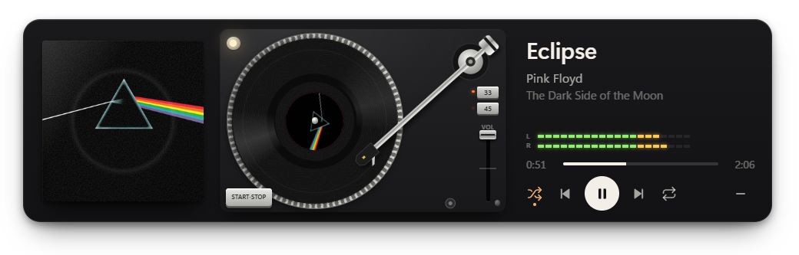

# Tocadiscos

Ventana flotante para Windows que muestra lo que suena en Spotify como un tocadiscos: la tapa del disco en el atril, el vinilo girando con la portada en la etiqueta y el brazo avanzando con el tema.



## Requisitos

- Windows 10 u 11
- Spotify de escritorio
- Node.js

## Instalar y abrir

```
npm install
npm start
```

`Ctrl+Alt+Espacio` la muestra y la oculta. Desde el ícono de la bandeja se puede cambiar el atajo, dejarla siempre encima o hacer que arranque con Windows.

## Controles

- **Brazo:** arrastralo sobre el disco para saltar a esa parte del tema; dejalo en el apoyabrazos para pausar.
- **START·STOP**, el botón de play o `Espacio`: reproducir y pausar.
- **Fader VOL** o la rueda del mouse: volumen de Spotify (solo el de Spotify, no el de Windows).
- `←` `→`: tema anterior y siguiente. Con `Shift`, retrocede o adelanta 10 segundos.
- `S` aleatorio, `R` repetir, `Esc` ocultar.
- La luz de arriba a la izquierda del plato fija la ventana encima de las demás.
- Clic en la tapa: abre Spotify.

## Cómo funciona

No usa la API de Spotify ni pide login. Spotify publica lo que está sonando en los controles multimedia de Windows (los mismos que aparecen al subir el volumen), y `runner/media.ps1` los lee y los usa para reproducir, pausar, saltar y cambiar aleatorio o repetir. El volumen se maneja desde el mezclador de Windows con `runner/AppVolume.cs`, que se compila la primera vez que arranca.

Los LED leen el audio que sale por los parlantes.

Por eso no puede marcar temas como favoritos ni cambiar el dispositivo de reproducción: Windows no da acceso a eso.
